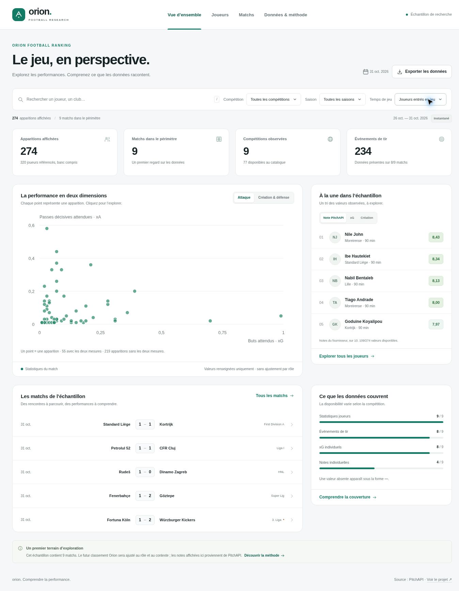

# Dashboard Orion

Le dashboard est un explorateur des données présentes dans le dépôt. Il propose une vue d’ensemble, une table de performances individuelles, un explorateur de matchs et une page sur la couverture et la méthode du futur classement.



## Utilisation

- Filtrer par compétition, saison, joueur ou club, et temps de jeu.
- Trier les apparitions par note fournisseur, buts, passes décisives, xG, xA, création ou défense.
- Passer des volumes du match aux volumes par 90 minutes ; la note fournisseur et les minutes restent inchangées.
- Sélectionner jusqu’à trois apparitions pour les comparer.
- Ouvrir un joueur depuis le tableau ou les graphiques ; ouvrir un match pour consulter les statistiques d’équipe, les tirs et le cumul des xG.
- Exporter les apparitions filtrées dans un CSV UTF-8. Les données manquantes restent vides.

Les filtres principaux et la page active sont conservés dans l’URL. Le raccourci `/` place le curseur dans la recherche. Les cartes de joueur et la comparaison utilisent une boîte de dialogue native, fermable avec Échap.

## Développement

Le frontend est en HTML, CSS et JavaScript natifs, sans dépendance à installer. Il nécessite un serveur HTTP ; ouvrir directement `index.html` avec `file://` ne permet pas le chargement fiable du fichier JSON.

Depuis la racine du dépôt :

```bash
python scripts/build_dashboard_data.py
python -m http.server 3000 --directory dashboard
```

Ouvrir ensuite `http://localhost:3000`. Python 3 est requis. `npm run serve` est un raccourci équivalent pour les environnements avec Node.js et npm.

## Vérification et construction

```bash
python -m unittest discover -s tests -v
node --test tests/dashboard.test.mjs
python scripts/build_dashboard.py
```

Les raccourcis `npm test` et `npm run build` sont également disponibles. La construction régénère l’instantané compact et copie uniquement les fichiers du frontend dans `dist/`. Ce dossier peut être servi par un hébergeur statique. Aucune clé API, variable d’environnement ou donnée privée locale n’est incluse.

## Actualisation

1. Mettre à jour les fichiers bruts avec le script de collecte existant.
2. Relancer la préparation des données et les tests.
3. Reconstruire et republier le dashboard.

Le navigateur ne sollicite pas PitchAPI directement et ne demande aucune clé. Le dashboard décrit un instantané : il ne prétend pas actualiser les résultats en direct.

## Contrats de lecture

Le [contrat de données](DASHBOARD_DATA.md) documente les agrégats, les champs et les valeurs manquantes. Les principes visibles dans l’interface sont les suivants :

- Une ligne représente une apparition. Le banc est exclu par défaut.
- Les notes sur 10 sont celles de PitchAPI ; aucun score Orion n’est calculé.
- Les xG/xA absents ne deviennent pas zéro. Les valeurs suspectes de 3. Liga sont masquées.
- La carte conserve les coordonnées du fournisseur et n’inverse pas arbitrairement les équipes.
- Le fil des xG cumule les valeurs de tir connues. Les buts contre son camp et événements sans mesure exploitable sont distingués.
- Les statistiques d’équipe utilisent la période `All` ; les blocs de statistiques joueur sont dédupliqués par clé.
- La méthode de classement reste à calibrer et à valider sur un historique adapté.

## Organisation

| Fichier | Rôle |
| --- | --- |
| `dashboard/index.html` | Structure accessible et navigation |
| `dashboard/styles.css` | Système visuel, adaptation mobile et états interactifs |
| `dashboard/app.js` | Vues, événements, filtres, comparaison et exports |
| `dashboard/model.js` | Fonctions pures de filtrage, tri et formatage |
| `dashboard/charts.js` | Graphiques SVG sans dépendance |
| `dashboard/data/football.json` | Instantané compact reproductible |
| `scripts/build_dashboard_data.py` | Normalisation des fichiers bruts |
| `scripts/build_dashboard.py` | Préparation du site statique |

Les fichiers de données tiers restent soumis aux conditions de leur fournisseur, comme indiqué dans la documentation principale.
