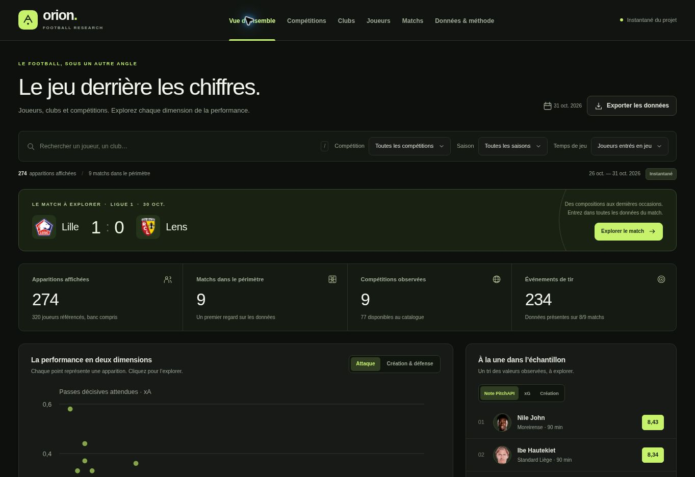

# Dashboard Orion

Le dashboard présente le projet dans une interface noire, avec les logos des clubs et les portraits fournis par PitchAPI. Ses six vues permettent d’explorer les performances, les compétitions, les clubs, les joueurs, les matchs et la méthode du futur classement.



## Utilisation

- Filtrer par compétition, saison, joueur ou club, et temps de jeu.
- Trier les apparitions par note fournisseur, buts, passes décisives, xG, xA, création ou défense.
- Passer des volumes du match aux volumes par 90 minutes ; la note fournisseur et les minutes restent inchangées.
- Sélectionner jusqu’à trois apparitions pour les comparer.
- Ouvrir un joueur depuis le tableau ou les graphiques ; ouvrir un match pour consulter les statistiques d’équipe, les tirs et le cumul des xG.
- Trier les arrêts et buts évités du fournisseur dans le tableau des joueurs ; les consulter aussi dans les fiches, la comparaison et les exports.
- Exporter les apparitions filtrées dans un CSV UTF-8. Les données manquantes restent vides.
- Parcourir les compétitions européennes collectées et ouvrir une saison ou un calendrier par date.
- Ouvrir une fiche club avec ses rencontres et joueurs référencés.
- Explorer 13 familles de données par match : compositions, statistiques des équipes et joueurs, mi-temps, tirs, événements, momentum, analyses avancées, réseaux de passes, cartes d’activité, confrontations et résumé.
- Consulter tous les champs disponibles du fournisseur et télécharger chaque réponse en JSON.

Les filtres principaux et la page active sont conservés dans l’URL. Le raccourci `/` place le curseur dans la recherche. Les cartes de joueur et la comparaison utilisent une boîte de dialogue native, fermable avec Échap.

## Développement

Le frontend est en HTML, CSS et JavaScript natifs, sans dépendance à installer. Il nécessite un serveur HTTP ; ouvrir directement `index.html` avec `file://` ne permet pas le chargement fiable du fichier JSON.

La commande locale du dashboard initial reste disponible, avec Node.js :

```bash
node dashboard/server.js
```

Ouvrir `http://127.0.0.1:8765/`. `npm run serve` est un raccourci équivalent. L’instantané préparé est inclus dans le dépôt ; aucune installation Python n’est nécessaire pour simplement le consulter avec ce serveur.

Toutes les données sont regroupées dans [`data/`](../data/README.md). Le serveur Node lit la base JSON dans `data/raw/` ; servir uniquement le dossier d’interface avec un serveur statique ne suffit plus. Pour un aperçu statique, construire le site puis servir le résultat :

```bash
python3 scripts/build_dashboard.py
python3 -m http.server 3000 --directory dist
```

Cet aperçu statique ne fournit pas les routes API.

## Vérification et construction

```bash
python -m unittest discover -s tests -v
node --test tests/*.test.mjs
python scripts/build_dashboard.py
```

Les raccourcis `npm test` et `npm run build` sont également disponibles. La construction copie les fichiers publics dans `dist/` et produit le Worker autonome `dist/server/index.js`. Seuls les assets explicitement autorisés sont embarqués. Aucune clé API ni configuration privée locale n’est incluse. La taille d'un instantané de saison complète doit être vérifiée avant toute publication ; l'archive brute locale n'est pas embarquée.

## Connexion PitchAPI et actualisation

La connexion utilise la variable serveur `PITCHAPI_API_KEY`. En local, elle est lue dans le processus ou le fichier `.env` ignoré par Git. Sur le site hébergé, elle doit être enregistrée comme secret de l’environnement Sites, puis appliquée par un déploiement. Le navigateur ne reçoit jamais la clé.

`GET /api/status` indique si une clé est configurée. Les ressources sont disponibles via `/api/pitchapi/…`, avec une liste fermée des 24 formes de routes documentées et des paramètres acceptés. Le serveur conserve les réponses dans un cache court, déduplique les requêtes et transmet les erreurs de disponibilité sans les transformer en zéros.

Sans clé, le serveur local peut consulter les réponses archivées pour les matchs collectés. Une fois la clé activée, les informations peuvent aussi être actualisées à la demande. Aucun classement de saison n’est calculé.

Pour reconstruire l’instantané local du projet :

1. Mettre à jour les fichiers bruts avec `node scripts/collect_europe.mjs`.
2. Relancer `node scripts/index_europe.mjs` et `python scripts/build_season_dashboard.py`.
3. Vérifier les données avant une éventuelle republication du dashboard.

Pour archiver tout le périmètre disponible, `python scripts/collect_pitchapi_all.py --all` collecte les index de toutes les saisons avant les détails des matchs terminés et les profils, avec points de reprise. `--plan` décrit ce périmètre sans clé ni réseau. La [documentation PitchAPI](PITCHAPI.md) précise les options et la structure des archives. Ces archives volumineuses ne sont pas embarquées dans le site ; l’explorateur utilise les mêmes ressources à la demande.

## Contrats de lecture

Le [contrat de données](DASHBOARD_DATA.md) documente les agrégats, les champs et les valeurs manquantes. Les principes visibles dans l’interface sont les suivants :

- Une ligne représente une apparition. Le banc est exclu par défaut.
- Les notes sur 10 sont celles de PitchAPI ; aucun score Orion n’est calculé.
- Les xG/xA absents ne deviennent pas zéro. Les valeurs suspectes de 3. Liga sont masquées.
- Les vues de réponses brutes conservent les valeurs originales de 3. Liga avec un avertissement explicite ; elles ne sont pas des mesures validées.
- La carte conserve les coordonnées du fournisseur et n’inverse pas arbitrairement les équipes.
- Le fil des xG cumule les valeurs de tir connues. Les buts contre son camp et événements sans mesure exploitable sont distingués.
- Les statistiques d’équipe utilisent la période `All` ; les blocs de statistiques joueur sont dédupliqués par clé.
- La méthode de classement reste à calibrer et à valider sur un historique adapté.

## Organisation

| Fichier | Rôle |
| --- | --- |
| `dashboard/index.html` | Structure accessible et navigation |
| `dashboard/styles.css` | Système visuel, adaptation mobile et états interactifs |
| `dashboard/app.js` | Vues, événements, filtres, comparaison et exports |
| `dashboard/explorer.js` | Compétitions, clubs, vues détaillées et chargement progressif |
| `dashboard/model.js` | Fonctions pures de filtrage, tri et formatage |
| `dashboard/charts.js` | Graphiques SVG sans dépendance |
| `data/raw/index.json` | Index de la base JSON par saison |
| `data/raw/seasons/` | Tables des joueurs, matchs, performances, tirs et observations |
| `worker/pitchapi.js` | Connexion sécurisée aux ressources du fournisseur |
| `worker/index.js` | Routage du site et assets publics autorisés |
| `scripts/build_dashboard_data.py` | Normalisation des fichiers bruts |
| `scripts/build_dashboard.py` | Préparation des assets et du Worker |
| `scripts/collect_pitchapi_all.py` | Collecte exhaustive, progressive et reprenable |

Les fichiers de données tiers restent soumis aux conditions de leur fournisseur, comme indiqué dans la documentation principale.
